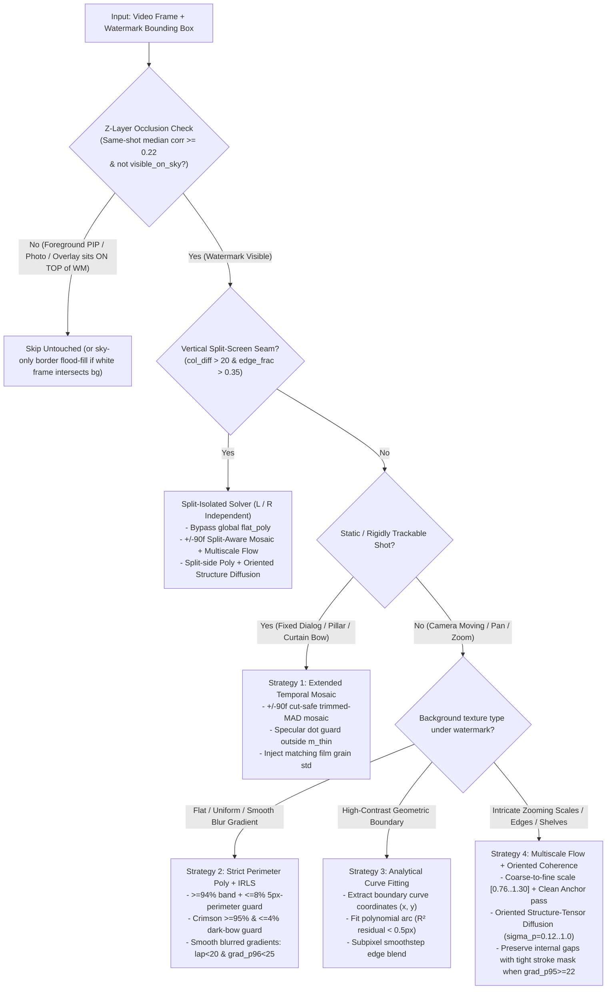

# Video Watermark Removal

## Overview

High-fidelity video watermark removal eliminates watermarks, logos, and burning text without leaving visual scars. Rather than applying a single blind inpainting algorithm across all frames, effective watermark removal uses **Scene-Adaptive Routing**: matching the repair strategy to the local scene geometry, temporal stability, and background characteristics.

```
Core Principle:
Never blindly inpaint. Classify the scene, cover the full drop-shadow, and recover true ground truth whenever temporal or geometric information is available.
```

---

## When to Use

Use this skill when tasked with removing static or dynamic watermarks, station bugs, or timestamps from video clips:

- **Symptom 1: Dark halo/blotch on flat backgrounds** (e.g. curtains, sky, walls) — caused by unmasked semi-transparent drop-shadows diffusing inward during inpainting.
- **Symptom 2: Jagged staircase edges or biting notches** across high-contrast boundaries (e.g. car wheel arches, vehicle panels, architectural edges).
- **Symptom 3: Blurry rectangular smear** on directional textures (e.g. fluted stone pillars, wood grains) — caused by edge-detection misclassifying watermark contrast as scene edges.
- **Symptom 4: Residual text between strokes** — caused by watermark trajectory drift over long frame intervals.
- **Symptom 5: Temporal flickering / breathing** — caused by frame-by-frame independent inpainting without temporal consistency or film grain matching.
- **Symptom 6: Flashing blocks & torn foreground edges in playback (invisible in single static stills)** — caused by ignoring foreground Z-layer occlusion (erasing clean unwatermarked PIP/photo layers), route flapping (`flat_poly <-> rolling`) from permissive `<85%` inlier thresholds, pasting misaligned moving objects from `t±12` across non-rigid motion or hard shot cuts, and leaving 1~2px outer watermark glow around `mask_stroke` on smooth out-of-focus backgrounds.
- **Symptom 7: Split-screen notches, smeared horizontal rails/collars & flickering blocks under fast camera zoom (`0 px/f` watermark)** — caused by: (a) running `flat_poly` / crimson IRLS (`85%` inliers) or isotropic `INPAINT_NS` across vertical split-screen seams (`x = seam_x`), dark curtain bows, or horizontal rails where whole-ring `Laplacian < 25` hides localized sharp edges; (b) limiting rolling buffers to `±12` frames on slow-drift shots (`0.13~0.14 px/f` needs `±90f`); and (c) lacking coarse-to-fine multiscale (`[0.76..1.30]`) + Clean Anchor temporal flow propagation when fast zooming textures pass beneath a stationary watermark.

---

## Decision Flowchart



---

## The Four Core Strategies

### 1. Flat & Gradient Backgrounds: Adaptive Drop-Shadow Masking + Polynomial Grain Fit
- **The Trap**:
  1. Most social media watermarks (Xiaohongshu, TikTok, etc.) contain bright core text surrounded by an asymmetric 1~3px semi-transparent dark drop-shadow (`rgba(0,0,0,0.3~0.5)`). Masking only bright strokes diffuses dark shadow pixels inward, leaving a dark blotch.
  2. **Channel-Mixing Std Bug**: Calling `np.std(bg_sample)` without `axis=(0,1)` computes std across B, G, R channels combined. On pure red (`BGR=[0,0,165]`), cross-channel std is ~`77.8` even with zero spatial noise—silently disabling flat-background routing! Always check per-channel spatial std or polynomial residual.
  3. **Over-Smoothing in Motion**: Plain spatial `cv2.inpaint` erases film/compression grain inside the patch, making a smooth moving color block noticeable when panning.
- **The Fix**:
  1. **Foreground Z-Layer Occlusion Check (CRITICAL before repairing)**: In composite edits (PIP cartoon clips, pop-up framed photo slideshows, animated overlays), watermarks often sit on a *lower background layer* occluded by foreground tracks. Compute the **same-shot 5-frame temporal median** high-pass correlation against `wm_template_hp` (`frame_mad <= 22` cut-safe): when `c_med < 0.22` (and not a chromatic subtitle-over-curtain overlap), skip untouched or flood-fill ONLY crisp outer sky pixels bounded by a genuine high-gradient white photo frame (`Sobel > 40` above subtitle rows)—never paint over clean foreground objects or photo interiors.
  2. Use an empirically calibrated full shadow-inclusive footprint mask (`mask_flat`) plus a strict **uniform-perimeter guard**: require **$\ge 94\%$ lower/band inliers (`|pixel - med|_max < 18`) AND $\le 8\%$ outliers in the `5px` ring touching `mask_flat`**! Why: permissive `~80%` thresholds allow a `10–17%` passing branch, collar, shoulder, or photo frame to slice into `mask_flat`, causing jarring `flat_poly <-> rolling` flapping and bitten object chunks!
  3. Fit a 2nd-order 2D polynomial per channel across inliers (`max_resid <= 6.0`). For smooth blurred gradient panels (`lap_ring < 24`, e.g., bokeh walls, defocused split side panels) or crimson shadow vignettes near titles, use a 2-to-3-pass **IRLS 2D quadratic fit** (`max_resid <= 5.0..8.0`) instead of `INPAINT_NS` (avoiding directional V-dips and gradient teardrops).
  4. Measure **high-pass** grain std (`roi - GaussianBlur(roi, (5,5), 1.0)`) rather than macro curvature residual, and inject matched noise (`0.8 * grain_std`) inside `mask_flat`. Protect crisp external edges using **`~mask_stroke`** (NOT `tight_dil`—using `tight_dil` leaves 1px anti-aliased stroke dots outside the core glyph mask!) and ignore isolated `< 12px` bright specks so small highlights don't leave crescent slivers.

```python
# Per-channel robust flat/gradient reconstruction (never use global np.std across BGR!)
ring_vals = roi[~m_flat]
med = np.median(ring_vals, axis=0)
inliers = (~m_flat) & (np.max(np.abs(roi - med), axis=2) < 18.0)

# Fit 2D quadratic polynomial per channel on inliers -> pred, check max(resid_std) <= 6.0
hp = roi - cv2.GaussianBlur(roi, (5, 5), 1.0)
grain_std = np.std(hp[inliers], axis=0)
noise = np.random.normal(0, np.clip(grain_std, 0.2, 2.0) * 0.8, roi.shape)
filled = np.clip(pred + noise, 0, 255)

alpha = cv2.GaussianBlur(m_flat.astype(np.float32), (5, 5), 1.0)
# Guard with full stroke+shadow mask (~m_stroke), NOT tight core mask!
edge_protect = (np.max(np.abs(roi - med), axis=2) > 55.0) & (~m_stroke)
if 0 < np.count_nonzero(edge_protect & m_flat) < 12:
    edge_protect = np.zeros_like(edge_protect)
alpha[edge_protect] = 0.0
```

---

### 2. Static & Rigid-Structure Shots: Temporal Clean Frame Fusion & Stepped Segmentation
- **The Insight**: When camera/objects are static or rigidly trackable (even under handheld shake), any drifting watermark leaves background pixels unoccluded in neighboring frames.
- **Stepped Rigid-vs-Dynamic Segmentation**: When a static rigid structure (e.g. carved stone pillar flutes) sits next to a changing background gap (moving people/cars behind it), never blend the whole shot blindly—segment static vs dynamic pixels via aligned temporal MAD (`temporal_mad < 7.5`):
  1. Subpixel-align shot frames onto a clean anchor strip of the rigid structure (`matchTemplate` + quadratic subpixel peak).
  2. Compute per-pixel median and temporal MAD across unmasked observations; pixels with low MAD (`< 7.5`) belong to the rigid structure and receive the clean aligned mosaic + matched grain (with 1D vertical fallback along flutes if any column pixel stayed occluded).
  3. Dynamic gap pixels outside the rigid mask use a stroke-preserving shadow mask + `cv2.INPAINT_TELEA`.

---

### 3. High-Contrast Geometric Boundaries: Subpixel Analytical Fitting
- **The Trap**: Spatial diffusion across strong geometric boundaries (e.g. white car body vs black tire, high-contrast door frames) bleeds the bright color into the dark area, creating jagged notches, teeth, and staircase artifacts.
- **The Fix**:
  1. Detect the boundary points $(x_i, y_i)$ along the clean sections of the boundary.
  2. Fit an analytical curve (e.g. 2nd-degree polynomial $y = ax^2 + bx + c$ or circle arc $(x-x_0)^2 + (y-y_0)^2 = R^2$) with $R^2$ residual $< 0.5$px.
  3. Apply subpixel smoothstep anti-aliasing along the signed distance $d = y - y_{curve}(x)$:
     $$\alpha(d) = 3t^2 - 2t^3, \quad t = \text{clip}\left(\frac{d + 1.5}{3.0}, 0, 1\right)$$
  4. Blend the clean light color and dark color smoothly along $\alpha$.

---

### 4. Natural Textures, Panning Motion & Directional Structure
- **The Traps**:
  - Running Canny edge detection inside a tiny watermark bounding box detects the watermark letters themselves, not the background.
  - Never run raw intensity bimodal thresholding (Otsu / K-means brightness split) inside a semi-transparent watermark mask: wherever watermark stroke + drop-shadow intensities straddle the foreground/background threshold, it hallucinates sharp bright/dark silhouettes of the watermark letters.
  - Stretching a small edge strip via `cv2.resize` over the hole creates vertical/horizontal motion streaks on natural textures; pixelwise nearest-color high-pass copying hallucinates blotches on smooth gradients.
- **The Fixes**:
  - **Split-Screen Seam Isolation & Guardrails (`edge_frac > 0.35`, `col_diff > 20`)**: Detect vertical split borders crossing the watermark ROI (`seam_x`) and NEVER run unsegmented `flat_poly` or isotropic diffusion across `seam_x`. Also guard crimson IRLS with `>= 95%` crimson inliers and `<= 4%` dark foreground outliers (protecting dark curtain bows), and guard gradient IRLS with `lap_ring < 20` and `grad_p96 < 25` so thin shelves/collars are never smeared.
  - **Extended `±90`-Frame Split-Aware Mosaic + Multiscale Flow & Clean Anchor Propagation**: Use a `±90`-frame sliding buffer (`stride=1` within `±16`, `stride=2` beyond) with affine lighting adjustment, 80%-trimmed ring MAD (`< 4.5`), and bright specular highlight preservation outside `m_thin` so slow-drifting watermarks (`0.13~0.14 px/f`) achieve `85–100%` clean coverage without clipping bokeh stars. When stationary coverage `< 90%` on structured scenes (`grad_p95 >= 16` or `seam_x` present), run coarse-to-fine (`0.5x` -> `1.0x`) multiscale `TM_CCOEFF_NORMED` flow (`scales 0.76..1.30`, dense offsets `±2..±45`) plus **Clean Anchor Propagation** (warping only frames/pixels `>= 88%` reconstructed directly from real raw donors within `<= 18f` with scales `0.84..1.18`, never cascading synthetic fills) to recover fast-zooming textures under pinned watermarks.
  - **Oriented Structure-Tensor Coherence Diffusion (Replacing Isotropic `INPAINT_NS` on Edges)**: For remaining uncovered pixels after temporal matching, first try split-isolated 2D quadratic surface fill (`rstd <= 5.5` for smooth side panels). Otherwise compute the clean known-ring Structure Tensor `(Jxx, Jxy, Jyy)` (`sigma=4.0`) per independent split side and iterate vectorized directional coherence diffusion (`sigma_p = 0.12 + 0.88*(1 - coherency)` along the minor eigenvector tangent). On crisp textured contours (`grad_p95 >= 22`), restrict the fallback mask to tight un-dilated `mask_tight` (`m_stroke_loc`) instead of `mask_flat` so clean 1~2px gaps between strokes guide straight shelves, curved collars, and scale ridges cleanly.
  - **Sky-Photo Z-Order Safety Guard**: Never allow `skip_z` (`c_med < 0.22`) to return an untouched frame when `visible_on_sky` is True (`clean_sky >= 40`, `str_sky >= 20`, stroke-minus-sky luma `> 10`), and use `sharp_wb >= 15` in `try_sky_border_z` so partial sliding photo frames still get sky pixels cleanly filled.
  - **Solid Title-Text Overlap (Two-Class Color Separation)**: When a watermark overlaps solid colored subtitles over a uniform curtain (verify yellow/text pixels actually touch dilated `mask_stroke`), separate classes via a blend-invariant chromatic cue (e.g. `G - B > 22 & R > 140` for golden-yellow on crimson red), inpaint each class solely from clean same-class pixels, and feather only the 1px border between classes.

---

## Trajectory Modeling: Avoiding Linear Drift & Periodic False Locks

When tracking moving watermarks across long video timelines ($> 500$ frames):
1. **Never lock onto bright title text**: Use high-pass Blue-channel or luminance templates gated by template energy ratio (`TM_CCORR / template_energy`) so `TM_CCOEFF_NORMED` cannot produce `corr=1.0` on tiny noise in uniform patches or jump onto bright title letters.
2. **Guard against periodic character-width shifts**: Multi-character watermarks with repeated glyphs (e.g. "球球") produce strong secondary correlation peaks at `±char_width` (~23px). Anchor episodes to robust piecewise-linear trajectories between real wall bounces, and handle brief edit zoom/shake transitions (e.g. 5~10 frame CapCut bounce cuts) explicitly by frame-by-frame coordinate verification.
3. **Dense Keyframe Verification**: Audit the full trajectory sequentially against the extracted real watermark template and inspect any interval with velocity kinks or low correlation.

---

## Quick Reference Table

| Scene Type | Primary Failure Mode | Recommended Repair Strategy | Key Parameter |
| :--- | :--- | :--- | :--- |
| **Occluded PIP / Photo layer** | Torn branches, collars, flashing photo borders, sky-half leakage | Same-shot 5-frame median `wm_corr` Z-layer gate + `visible_on_sky` anti-skip guard | `c_med < 0.22`, white border `sharp_wb >= 15` |
| **Pure red/blue/flat curtain** | Dark Blotch / Bow smear / Flapping | Strict 2D Poly + `mask_flat` + High-Pass Grain + crimson `>=95%` & dark-bow guard (`<=4%`) | `band >= 94%`, `5px perim <= 8%`, `resid <= 6.0` |
| **Vertical Split-Screen / Defocused Bokeh** | Cross-seam color tooth / notch & V-dip | Explicit vertical seam isolation (`col_diff > 20, edge_frac > 0.35`) + L/R split Mosaic/Poly/Diffusion | Independent L/R sides, `rstd <= 5.5` |
| **Static Bow / Slow-Drift Scenes** | Blurry blotch from narrow `±12f` buffer | Extended `±90f` Trimmed-MAD Split Mosaic + outside-`m_thin` specular dot preservation | `trim_mad < 4.5`, specular `max > 195` |
| **Fast Zoom / Intricate Armor Scales** | Severe playback mosaic blocks under `0 px/f` WM | Coarse-to-fine (`0.76..1.30`) Multiscale Flow + Clean Anchor (`>=88%` raw) Propagation | `MAD < 10.5`, `anchor <= 18f`, `off=±2..±45` |
| **Wooden Rails / Clothing Collars** | Wavy horizontal blur / jagged diagonal notch | Oriented Structure-Tensor Coherence Diffusion on un-dilated `mask_tight` when `grad_p95 >= 22` | `sigma_p = 0.12..1.0`, `70` iters |
| **Rigid structure + moving gap** | Blurred flutes / mixed background dot | Subpixel Alignment + `temporal_mad` Segmentation | `MAD < 7.5`, Telea gap fallback |
| **Solid title text over curtain** | Text strokes chewed or smeared | Two-Class Chromatic-Separated Inpainting | e.g. `G - B > 22` touching `mask_stroke` |
| **Car wheel arch / Curved edge** | White jagged notches / steps | Analytical Polynomial Curve Fitting | Poly deg=2, smoothstep 3px |
| **Subtitle text / edit shake** | Watermark drift / residual strokes | Piecewise-Linear Fit + Shake Keyframes + HP Match | Guard `±char_width` false locks |

---

## Export & Encoding Standards

Always maintain pristine video and audio quality:
1. **Single-Pass Lossless Pipe**: Pipe raw `bgr24` frames directly into `ffmpeg` `stdin` rather than writing an intermediate `cv2.VideoWriter(..., 'mp4v')` file—eliminating an entire generation of MPEG-4 macroblocking on smooth red/blue gradients. (Set `stderr=subprocess.DEVNULL` or redirect to a log file to avoid pipe buffer deadlocks.)
2. **Video Codec**: `libx264`, `-crf 17`, `-preset fast`, `-pix_fmt yuv420p` (visually lossless).
3. **Audio Codec**: `aac`, `-b:a 192k` (stereo, matching original audio sample rate).
4. **Timeline Alignment**: When trimming start frames (e.g. eliminating black screen or intro transitions), offset audio synchronously:
   ```bash
   ffmpeg -y -f rawvideo -vcodec rawvideo -s 720x400 -pix_fmt bgr24 -r 30 -i - \
     -ss <START_SEC> -i original.mp4 -map 0:v:0 -map 1:a:0 \
     -c:v libx264 -crf 17 -preset fast -pix_fmt yuv420p -c:a aac -b:a 192k -shortest output.mp4
   ```
5. **Five-Dimensional Verification Audit (Zero Scan Blind Spots)**: Relying solely on static stills, whole-ring mean Laplacian (`>= 18`), or top-K rankings capped at `top_k=12` misses localized 1px split-screen notches, horizontal shelf rails, diagonal collars, and 10-second sustained flicker episodes! Always run ALL FIVE checks across every watermarked timeline frame and print a **30-second full-timeline bucket health summary** before visually inspecting **5-frame consecutive MP4 filmstrips (`L=Orig | f-2 | f-1 | f | f+1 | f+2`)**:
   - **Motion-Compensated Inter-Frame Excess Flicker Audit**: Align consecutive rendered frames `t-1 -> t` across ALL trajectory frames and measure `excess_flicker = (proc_in - proc_out) - (orig_in - orig_out)` and `p95` across `mask_flat`.
   - **Split-Seam & Directional Edge Break Audit**: Compute `p92` normalized Sobel gradient drop between clean ring and mask interior (`not diluted by whole-ring mean!`) plus vertical column discontinuity (`full_step` outside vs inside ROI) to catch every split-screen notch and shelf/collar blur.
   - **Moving Blob, Smooth-Background Deviation & Residual Watermark Correlation Audits**: Catch multi-frame temporal blotches, `ring_std < 18` dark/light spots, and faint surviving watermark strokes (`orig_c` vs `wm_c`).
